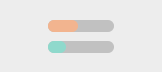
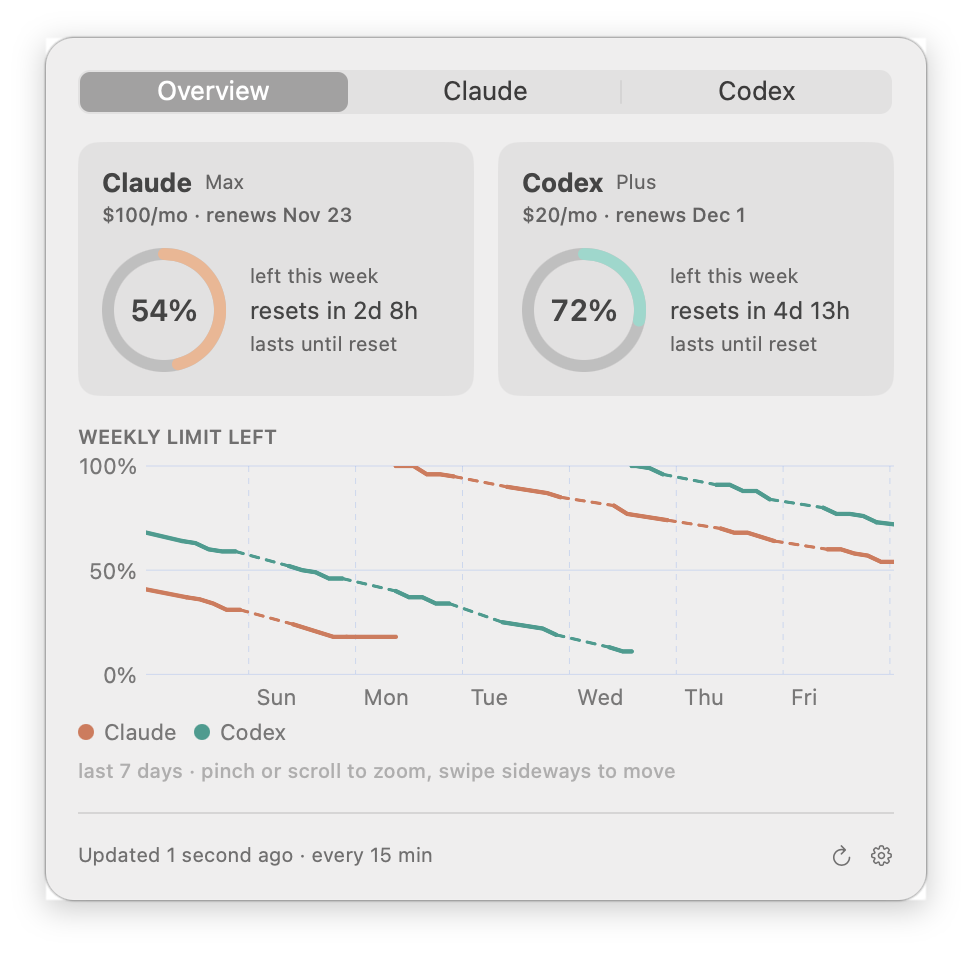
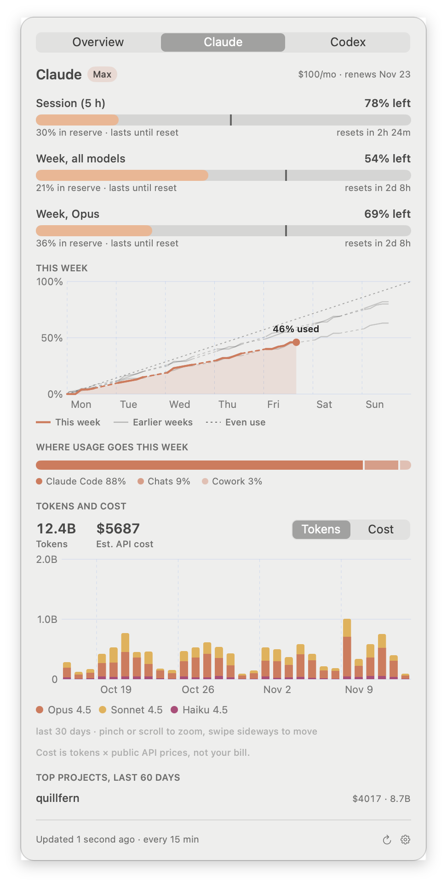
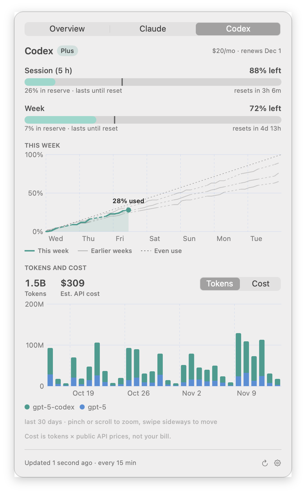
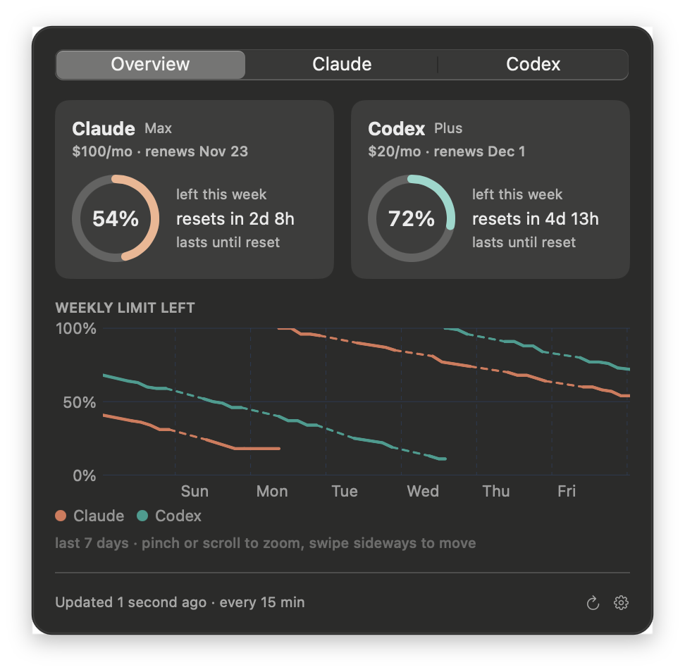
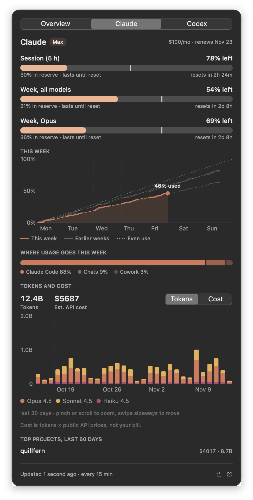
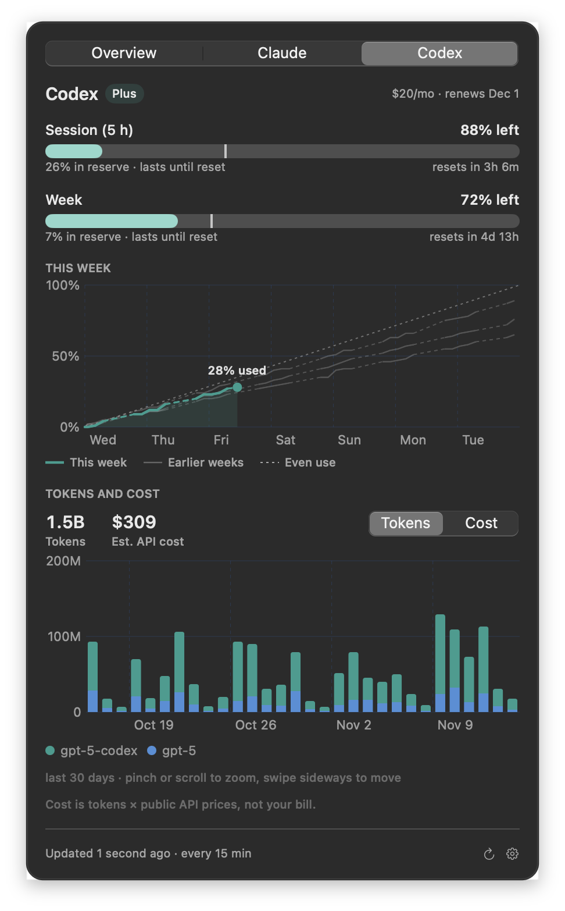

# AI Paceline

[](https://github.com/danylkaaa/ai-paceline/actions/workflows/ci.yml)
[](https://github.com/danylkaaa/ai-paceline/releases/latest)
[](LICENSE)

A macOS menu bar app that shows how much of your Claude and Codex subscription limits you have left, and whether you
are on pace to last until the reset.

<p>
  
</p>

| Overview | Claude | Codex |
| --- | --- | --- |
|  |  |  |
|  |  |  |

The screenshots use `--demo` data: every number and project name is made up.

## Features

- **Menu bar**: two small bars, Claude on top, Codex below. Each bar fills with the weekly limit used; it gets deeper
  in color as usage grows and turns grey when the numbers are stale. Hover shows the exact numbers.
- **Panel**: rest the pointer on the item to open it, click to keep it open, click outside to close it.
  - **Overview**: plan, monthly price and renewal date, % left this week, and the weekly limit over time.
  - **Claude / Codex**: every limit with a pace marker (even use until the reset), this week against earlier weeks,
    tokens and estimated API cost per day by model, and the top Claude projects.
- **Charts**: pinch or scroll to zoom the time window, swipe sideways to move back in time. Dashed lines mark stretches
  without data.
- **Settings**: refresh every 5, 15, 30 or 60 minutes, choose which bars to show, enter your monthly prices, start at
  login.

## Install (Apple silicon)

Needs macOS 15 or later on an Apple silicon Mac, and Node.js for the token charts (they run `npx ccusage`).

1. Download [`AIPaceline-macos-arm64.zip`](https://github.com/danylkaaa/ai-paceline/releases/latest/download/AIPaceline-macos-arm64.zip)
   from the [latest release](https://github.com/danylkaaa/ai-paceline/releases/latest).
2. Unzip it and move `AI Paceline.app` to `~/Applications` or `/Applications`.
3. The app is ad-hoc signed and not notarized, so macOS blocks the first start. Remove the quarantine flag once:

   ```sh
   xattr -dr com.apple.quarantine ~/Applications/"AI Paceline.app"
   ```

4. Open the app. It reads the logins of Claude Code and Codex on this Mac; there is nothing to set up. On first start
   macOS may ask to let it read the `Claude Code-credentials` Keychain item: choose "Always Allow".

To check the download: `shasum -a 256 -c AIPaceline-macos-arm64.zip.sha256` (the `.sha256` file is in the release).

## Build from source

Needs the Xcode Command Line Tools (`xcode-select --install`) and [Task](https://taskfile.dev).

```sh
task install      # build AI Paceline.app, copy it to ~/Applications and start it
task run          # build and start from build/
task test         # unit tests
task screenshots  # demo-mode screenshots in light and dark mode into docs/screenshots
```

Launch flags:

| Flag | What it does |
| --- | --- |
| `--demo` | Made-up data. Reads no account and saves no settings or history. |
| `--open overview\|claude\|codex\|settings` | Opens the panel at launch and keeps it open. |
| `--appearance light\|dark` | Forces the panel's appearance. |

## Where the numbers come from

| Data | Source |
| --- | --- |
| Claude limits | `https://api.anthropic.com/api/oauth/usage`, with the Claude Code login token from Keychain item `Claude Code-credentials` |
| Claude plan, renewal | `https://api.anthropic.com/api/oauth/profile`. It has no renewal date; the app guesses it from the subscription start day and shows it with `~` |
| Codex limits, plan | `https://chatgpt.com/backend-api/wham/usage`, with the token from `~/.codex/auth.json`; the newest `rate_limits` in `~/.codex/sessions` when that fails |
| Codex renewal | `https://chatgpt.com/backend-api/subscriptions` |
| Prices | Settings. Neither server reports the price |
| Weekly % history | Saved on each refresh in `~/Library/Application Support/AI Paceline/history.json`; Codex history also comes from its session logs |
| Tokens and estimated cost | `npx ccusage@20.0.50` (`claude daily --instances --breakdown`, `codex daily`) |

- Both usage endpoints are internal, not public APIs. They can change without notice. When one fails, the app keeps
  the last numbers, greys the bar and says why in the panel.
- The app never refreshes login tokens: that would replace Claude Code's or Codex's own token. When a token expires,
  open Claude Code or Codex once.
- Token charts only cover usage logged on this Mac.
- Nothing leaves your Mac except the requests to those two usage servers, and npm when `npx` downloads ccusage.

## Troubleshooting

- **No bar for a provider**: you are not logged in to it on this Mac.
- **Grey bar**: the last fetch failed. Open the panel to see why.
- **Icon not visible**: on a MacBook, menu bar items behind the camera notch are hidden. Quit some other menu bar apps.
- **"Token history not available"**: `npx` was not found or ccusage failed. Check `zsh -lc 'npx -y ccusage@20.0.50 --help'`.
- **Logs**: `log stream --predicate 'subsystem == "io.github.danylkaaa.aipaceline"'` shows only failures.

## License

[MIT](LICENSE)
